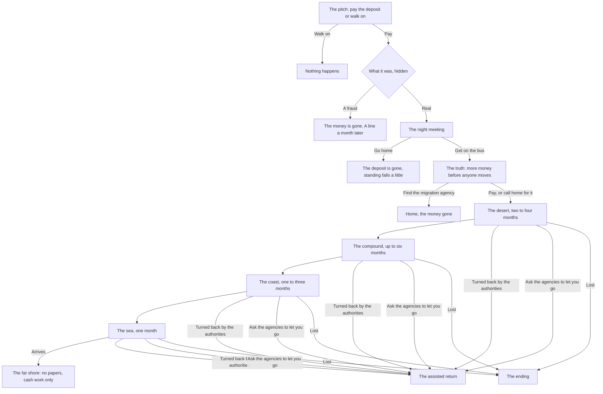

# The road

The road is the one way out that asks for no papers. It is never named. It arrives as an offer that beats every formal route on every number you can see: cheaper than the visa fee, three weeks to Europe, leave on the next one. You learn what it is in steps, and at each step the list of things you can do gets shorter. Exits exist at every step and are shown. The game follows reporting on the real journey north through the desert and across the sea, and it ends, whichever way it ends, with a card that points at that reporting.

::: danger What this page describes
People really take this road, and many do not come back. The game shows it plainly, with stylised numbers and no usable detail: no real places beyond the stylised, no real prices, no contacts, no methods.
:::

## The pitch

Three pitches can reach a life at home: an advert on the radio, a man at the motor park, a cousin's friend. Asking around at the motor park opens the park's pitch at once for the curious. Each pitch comes up more often when life is going badly (refusals on record, a loan in default, low standing, age past thirty) and less often when a formal route stands strong (japacity 60 or more). It sits last among the things waiting on you.

The pitch shows what you notice: "It costs less than the visa fee alone.", "Nobody has mentioned a visa, a form or an office.", "He wants the deposit today, in cash." It never says desert, sea, road or danger.

## The steps

Each month on the road is one draw for the step you are on: you move on, you are held another month (with a call to your family for a ransom), you are turned back, or you are lost. Read as the record reads: of those who set out, about 22 in 100 arrive, about 2 in 100 are lost, and the rest are held, turned back or leave by the exit.

## On the road

From the moment you set off there is one screen: the month's lines, a card that says there is a way back ("The anti-trafficking agency and the migration agency bring people home from this road, whatever they paid."), "Ask them to let you go", and "Wait a month". No phone, no japacity, no share card, no advert, no news from home. The job at home ends when you set off; the house's bills stop and come back when you do. Everything the life owned in Lagos is sold at its resale share as you leave, and one line tells it: "Before you left, what you owned was sold", with what came in.

::: warning The ransom call
When you are held, your family gets a call. They pay, and the family's means and your standing fall; or they cannot, and the sum goes on a debt to the agent that follows you home, and you are worse for it.
:::

## How it ends

| Ending | What follows |
|---|---|
| Turned back, or the exit taken | The assisted return home: standing falls hard, the agent's debt stays open in naira, and the house takes you back |
| Arrived | A shared room on the far shore with no papers, cash work only, the debt still open. The only way on is home |
| Lost | The end of that character, for good. The ending card and the real-story card show, and nothing else can be done |

After the road ends in any way but a fraud, the real-story card names the journalism the road follows. Nothing from that reporting is reproduced in the game. Each credit, with its link where there is one, is also on [Every source](./sources.md).

::: details Exceptions
- **A fraud** ends at the deposit. No night, no truth, no real-story card.
- **Calling home** at the truth makes the family pay: their means fall with the amount, and standing falls.
- **Short of money** at the truth: cash pays what it can and the rest becomes the agent's debt.
- **A pitch left open** through a flight cannot start the road abroad: taking it needs you at home.
- **The switch.** The whole road can be turned off in the content.
- **Nothing is earned** anywhere on the road: no japacity point, no share card, no collection.
:::

## Rules it rests on

- [The road](../../rules/road.md).
- [Place](../../rules/place.md): place:departure-moves-abroad (what is let go and sold on leaving), place:return-home-paid-or-assisted, place:return-shape-decided-at-once, place:family-takes-you-back (the assisted return and what reopens).
- [Coming home](../../rules/return.md): return:standing-by-return-shape (standing on return).
- [Routes, schools and the interview](../../rules/route.md): route:open-set-piece-holds-month (a set piece holds the month).
