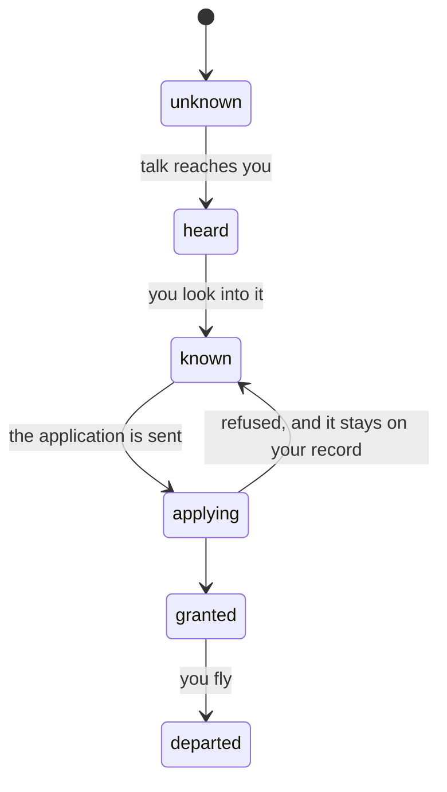
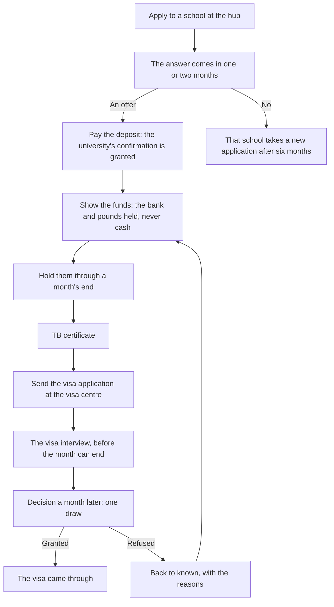

# Routes and japacity

A route is a way out of the country: a master's in the UK, health care, the talent visa, skilled work, permanent residence in Canada, a contract in the Gulf, the partner routes, and the road. Nobody picks one at the start. You hear of a route, look into it, and find out how much of it your life already meets. Japacity is that figure: how ready you are to go, from 0 to 100, the best of the routes you know. This page follows a route from hearing of it to the day the visa is decided.

## How a route moves

You hear of a route through a friend once your life fits it (a degree for the master's), at the first meetup for the talent visa, or by asking around at the motor park for the Gulf. Hearing only puts its name in Japa. Looking into it shows its checklist and gives it a japacity figure.

## Finding out where you stand

There are four ways to look into a route. Each trades money, time and risk.

| Way | Where | Cost | Is it true? |
|---|---|---|---|
| The official page | The hub's desk in Yaba, or Japa on the phone | Free | Always. It shows the full list as the route holds it today, and nothing about your chances |
| Someone who went | The hub, with a friend abroad or enough network | Free, answers at once | As it stood when they left. If the rules changed since, one item they name is wrong |
| The licensed adviser | The hub's long desk | ₦80,000, by transfer | Always. Reads your whole file: what fits now, what is missing, and "at least N months" away |
| An agent | The stop at Ojuelegba | A fee drawn from a range | Depends on the agent |

Reading the official page corrects any wrong item a friend or an agent gave you.

::: warning Agents
An agent is cheap and fast, and is one of four kinds: a fixer (brings a paper or appointment forward two months), a chaser (one month, cheaper), an overpromiser (promises a month he cannot keep), or a scammer (gives nothing). The fee never tells you which: the ranges overlap. Every agent shows one sign at once, and three free looks on his sheet find the rest before you pay: ask for his office, ask for his licence number, check his name with someone you know. A scammer carries at least two signs; a fixer at most one. Being careful is something you do.
:::

## Japacity

Each route's checklist adds up to 100. A met item earns its whole weight. The funds item is the long bar: it fills in part as your savings grow, and falls when the naira falls or a rule changes. A granted or departed route stands at 100. Your japacity is the best figure among the routes you know whose window is not closed, and those already under way. With none, it reads "no route yet".

| A master's in the UK | Weight |
|---|---|
| Degree, grade, passport, transcript | 6, 4, 4, 3 |
| English band 6.0 or better | 12 |
| An offer from a school | 12 |
| Deposit paid | 12 |
| Funds shown cover the funds required | 28, filling in part |
| Funds held at a month's end | 8 |
| TB certificate, application sent | 4, 7 |

::: info The plan
The chapters follow one way out, the plan. By default it is the first way of your own effort you looked into, else the first you heard of, else the master's. Japa names it ("Your plan: health care"). Opening another way's page says what switching would do to japacity, with "Keep mine" and "Make this the plan". Once a visa is granted, the grant decides: the plan and the chapters follow the way granted, whatever the plan was, and the flight on it brings the send-off.
:::

## The points

Permanent residence in Canada has no school and no sponsor. It has a score: points for your age, your education, your English and your work abroad, worked out each time and shown on the route from the day you know it. Entering the pool needs the degree assessment, English at band 6.0, twelve months of work and the funds Canada asks for. While your profile is live, the world's cut-off moves; when it falls to your score, you are invited and the application is on its way. A profile lapses after twelve months with no invitation. Age points fall with each birthday, so the score is a clock.

## The file and decision day

For the master's, the file is the [file chapter](./papers.md): passport, transcript, English, an offer. Decision day is the third chapter: "Now the money. Show it, hold it, and answer for it."

The chance of a refusal starts at a base and moves with how strict the world is, how much of the funds you cannot explain, earlier refusals, how the interview went and a good grade. It never falls below 3 in 100 or rises above 80 in 100. A clean file with a good interview is refused about 6 times in 100. The score of the interview is never shown.

## The visa and the flight

A grant moves the route to granted and japacity to 100. The decision day card opens over the world. That month the family house offers a send-off: a party, a quiet last dinner, or no time. Japa's next step is "Board the plane": the airport opens as the send-off scene (the queue, the counter, the gate), and Board the plane at the gate is what sends the flight. Flying needs the held-funds loan paid back, if one was taken, and the flight, ₦1,600,000 in naira, unless the employer pays it (the Gulf contract). Then the life carries on abroad: see [Abroad](./abroad.md).

::: details Exceptions
- **A refusal.** The route goes back to known and its refusals go up by one. The health surcharge comes back at once; the deposit, less a £500 fee, two months later. The school's offer stands, so the deposit can be paid again. The reasons are recorded, most telling first: the funds, the interview, an earlier refusal, or credibility.
- **A closed window.** While a route's window is shut, no school or visa application can be sent; one already sent is still decided.
- **Fake papers.** A route that checks a paper refuses an application that used a fake one.
- **A ban.** A deception or a removal shuts every route into that country for years. The route reads "refused" until the ban ends.
- **Held funds.** Once a visa is granted, no held-funds loan is offered: the funds have done their work.
- **The road** never appears among the routes and has no figure. See [The road](./road.md).
:::

## Rules it rests on

- [Routes, schools and the interview](../../rules/route.md): the states, schools, funds, decision day, the flight.
- [Japacity](../../rules/japacity.md).
- [Finding out where you stand](../../rules/advice.md): the four ways, agents and their signs, the chaser.
- [Route gates](../../rules/route-gates.md): the gates, the points, and the sponsor, endorsement and contract gates.
- [Chapters](../../rules/chapter.md): chapter:family-marks-the-grant (the send-off at home), chapter:chapters-follow-lean-route (the plan), chapter:view-says-closes-and-next.
