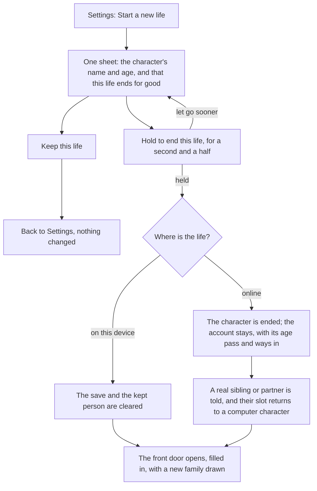

# Settings and a new life

Settings is the last app on the phone. It holds the few choices a player makes about the game itself:

- whether it makes sounds;
- how hard the city works the phone's graphics;
- the account, when there is one;
- a box for telling the team something;
- the way out of this life into a new one.

Everything here is plain and reversible except starting a new life, which ends this one for good and is guarded so it cannot happen by accident.

## The choices

| Setting | Choices | Kept where |
|---|---|---|
| Sound | On or Off | On this device |
| Graphics | Let the game choose, Low or High | On this device; the city takes it the next time it opens |

**Look.** There is one look and nothing to choose. By day the sheets are pale sky with white cards, navy ink and danfo yellow for the one action. At the world's night the same shapes turn navy with cream ink, following the world's clock, and the yellow action stays. The 3D city keeps its own colours.

**Sound.** The interface's sounds are small cues made on the fly (a tap, a coin, a confirm, a whoosh), with no sound files. The visa officer speaks the interview's lines from short recorded clips. Off silences both, and a muted game fetches nothing.

**Graphics.** The city has two modes. Left to the game, a phone starts low, rises to high when its frames keep up, and drops back for the session when they do not; a desktop starts high. Low or High fixes the mode on this device. Low also means fewer people in a place.

::: details The account, online
When the life is online, an Account heading and button open the account's own settings:

- the username and how to change it;
- sending usage counts (on by default; off stops the interface's counters at once);
- a notice on this device when your months are full after a while away (the switch reads Tell me when my months are full);
- a passkey, once the life is secured;
- signing out and deleting the account;
- the links to the terms and privacy pages.

A guest sees a quiet reminder that the life lives only on this phone until it is secured. Offline there is no Account heading at all. See [Accounts](./accounts.md).
:::

::: details Feedback and From the team, online
Online, a **Feedback** row opens a short box that only the team reads. When the team has acted on this account or decided one of its reports, a **From the team** row shows what was done, with its one appeal. See [Moderation and the legal pages](./moderation.md).
:::

## The Credits

The Credits row sits under About the game, near the foot of Settings, beside the guides. It opens the same short screen as the menu of Look around on the road:

- the map data line, with OpenStreetMap linked;
- sound and art from others;
- the fonts;
- one plain line on where generated media is used;
- the game's own licences, with a link to the full list in the repository (`LICENSES.md`, and `NOTICES.md` for every package the game ships).

It is in Settings for every player, online or not.

## Start from a ready life

Where a life may be started over on this device (the game played locally), **Start from a ready life** opens the front door on the ready lives: lives that skip the years before and start at work. See [The ready lives](./ready-lives.md).

## Start a new life

The sheet names the character and their age, and says plainly that this life ends and cannot be brought back, and that a new life starts at the door with a family of its own. **Keep this life** is the easy choice. The ending button must be held, by a finger, a mouse, or Enter or Space; there is nothing to type.

::: info A new family, not the old one
The new life draws its own family. Nothing is kept from the old life's draw, and no invite or family member is needed to start again.
:::

::: details Online, and when someone plays with you
Online, a guest who starts again gets the new life under the same guest account and username, and the bot check is not asked again. A real sibling or partner joined to the old life is told it has ended, in the game's words; the bond ends at no cost to either side and the moments are kept. If the ending fails, the sheet says so and the life stays.
:::

## Rules it rests on

- [The world](../../rules/world.md): the phone's apps (world:phone-rises-over-scene), the one look with its day and night paints (world:colours-are-role-tokens), sound (world:interface-sounds-made-live).
- [Accounts](../../rules/account.md): Start a new life (account:start-a-new-life), one character at a time (account:one-character-per-account), deleting the account (account:player-deletes-account), securing a guest (account:guest-secures-the-life, account:guest-reminded-to-secure), the username (account:username-and-unconfirmed-email).
- [People](../../rules/person.md): a restart ends a bond at no cost (person:leaving-player-ends-bonds).
- [The prologue](../../rules/prologue.md): the ready lives reached from Settings (prologue:front-door-three-screens), a new family draw (prologue:tile-path-open-from-start).
- [The city](../../rules/city.md): the graphics modes (city:two-graphics-modes) and people in a place in each mode (world:place-is-one-screen on the world page).
- [Guides, sources and credits](../../rules/guide.md): the Credits (guide:credits-screen-in-game, guide:credits-carry-map-line, guide:credits-state-licences), reached from here and from the menu of Look around on the road (city:credits-screen-attributions).
- [Analytics](../../rules/analytics.md): sending usage counts (analytics:player-can-stop-usage-counts).
- [Moderation](../../rules/moderation.md): the feedback box (moderation:feedback-box-in-settings) and the team's notice (moderation:actioned-player-told-and-appeals).
- [The clock](../../rules/clock.md): the notice when your months are full after a while away (clock:full-bank-push-notification).
