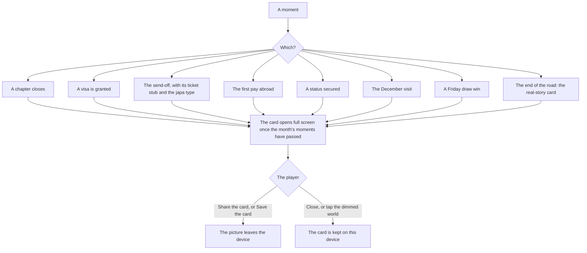
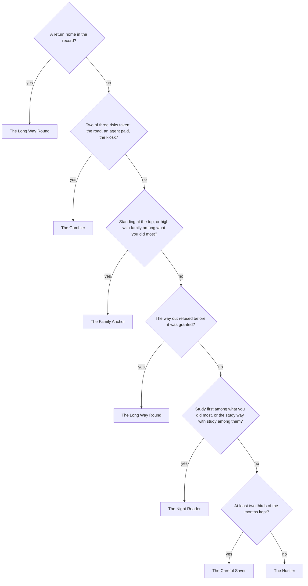

# Share cards and the japa type

At a moment worth telling (a chapter done, a visa granted, the send-off), the game offers a card: a picture you can send to friends. Most people will first hear of the game through one, so a card is built never to be mistaken for anything real. It carries no sum of money, no logo, no reference number, and the words "Japacity is a game" in plain sight. At the send-off the game also reads the life as one of six japa types: a label for sharing, never a score.

## When a card is due

::: danger A card never celebrates harm
No card is due for a refusal, a removal, a forced return, or anything on the road except the real-story card. A life that ends on the road gets a card for the player alone, with no share button.
:::

## What is on a card

- The moment's title, the character's first name, and the japacity figure and the way out where the moment has them.
- The months played, how home sees you, and what you did most.
- The chapter's own art, with the character seen from behind or in silhouette, never a face.
- The game's name as the sender, its address, the official accounts page, and "Japacity is a game", no smaller than the address.

Every share picture also carries three marks so it never passes for proof: a faint watermark of the game's name across the background, a corner badge with the name, and the branding with the address at the foot.

::: warning What a card never shows
A sum of money in any currency (a sum on a picture is the part a scammer crops and reposts as proof), a bank alert or receipt look, a crest, a barcode, a real institution's name, another player, a display name, or a computer character presented as a player.
:::

## Offered, never sent

A card is offered: nothing is posted for you, and nothing is earned by sharing.

- The button under the card says **Share the card** where the phone has a share sheet, and **Save the card** where it has none.
- The picture is drawn on the device as a portrait image the size of a messaging status, under 150 KB, with the marks drawn on before it is encoded.
- The words that travel with it are a link to the game with the card's kind and nothing about the player. The preview a messaging app shows for that link is a fixed, approved picture for that kind.
- A card is never stored on the server. Closed cards are kept on this device, for this life.

## The send-off and its ticket stub

At the send-off, two pictures are offered side by side and you pick which to share:

- the send-off card;
- a ticket stub drawn on paper over the departure art, with FROM, TO, MONTHS and JAPACITY, the japa type as a badge, and the first name.

The stub names places only: no airline, no seat, no barcode, no airport code, so it never reads as a real ticket.

## The japa type

When the send-off card is due, the life is read as one of six types, each with one line in a person's voice.

| Type | Its line |
|---|---|
| The Careful Saver | I spent less than I made. Most months, anyway. |
| The Hustler | I took the work that was there. Sleep could wait. |
| The Night Reader | I read while the house slept. It carried me out. |
| The Family Anchor | Every call from home, I picked up. |
| The Gambler | I took the chances other people only talk about. |
| The Long Way Round | It took longer than planned. I went anyway. |

The checks run in this order, rarest first, and the first that holds decides the type:

The type is never a number, never money, and never changes the simulation. Once the send-off card is closed, the type is kept on this device with the card, and the [data page](./front-door.md) shows it as a row of its own.

## The official accounts page

Every card, the terms, the privacy notice and the guides link to one page, `/official`. It lists the game's web address, its email and each account the game holds. It says plainly that the game never asks a player for money, never sells months to play, never messages first about a prize, and has no agents. It gives the address to report an account pretending to be the game.

## Rules it rests on

- [Share cards and the official accounts page](../../rules/share.md): when a card is due (share:cards-due-at-set-moments, share:no-card-for-harm and share:card-offered-never-sent), what is on it (share:card-contents, share:card-carries-no-money, share:card-never-looks-official, share:card-art-shows-no-face and share:card-shows-only-own-character), size and how it travels (share:card-drawn-on-device, share:card-link-has-fixed-preview and share:card-never-stored), the official page (share:official-accounts-page, share:official-page-warns-plainly and share:everything-links-to-official).
- [Chapters](../../rules/chapter.md): the send-off card (chapter:send-off-card-on-close).
- [The road](../../rules/road.md): the real-story card (road:road-earns-nothing, road:real-story-card-after-chain).
- [Money](../../rules/wallet.md): the months kept that the Careful Saver reads (wallet:months-kept-counted).
- [People](../../rules/person.md): no computer character shown as a player (person:computers-never-shown-as-players).
- The japa type: decision 0024, `docs/decisions/0024-the-japa-type.md`.
